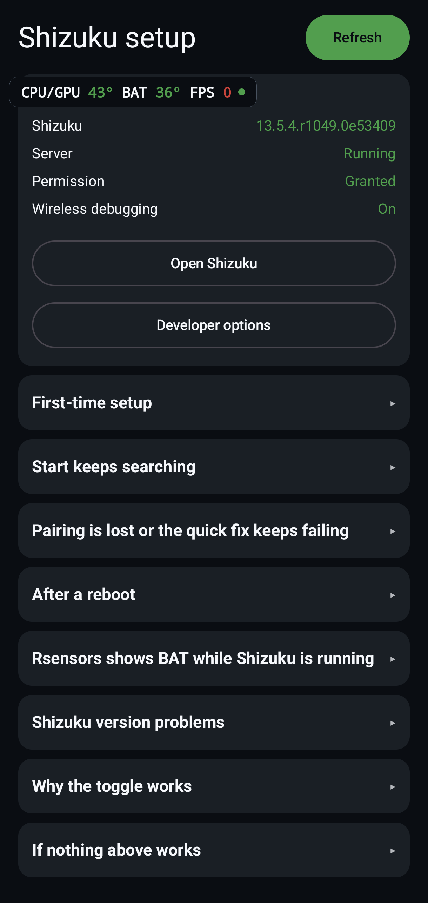

# Rsensors

A floating overlay for Android that shows live CPU/GPU/battery temperatures, the
foreground app's frame rate, and per-app memory usage. CPU/GPU, FPS and process
memory access use [Shizuku](https://shizuku.rikka.app/).


## Features

- **Collapsed pill**: `CPU/GPU`, `BAT`, `FPS` and `RAM`, with a source dot.
  Values follow the green / amber / red bands and dim when the sample is stale.
  CPU/GPU shows the hotter SoC value and uses the worse of the two levels; RAM
  is used decimal GB in blue and stays visible when the sensor reading is
  missing.
- **Expanded card**: individual CPU, GPU and battery readings, each with the
  maximum and minimum over the last 2 minutes; thermal status; FPS; system RAM
  used/total with a compact usage bar; a 2-minute sparkline with a
  `CPU+GPU / CPU / GPU / BAT / FPS` selector; and CPU/GPU / BAT / FPS / RAM
  chips that choose what the pill and notification show.
- **Process memory**: tap the card's RAM row for a paged list of the top memory
  consumers from the platform memory service, eight per page. `Apps` groups by
  package and hides native/system rows; `Processes` shows every process.
  `Refresh` takes a new snapshot; `Back` returns to the card. The normal pill
  keeps updating while the page is open. Without Shizuku the page explains why
  it is unavailable and offers the setup action.
- **Real temperatures**: CPU/GPU from the platform thermal service through
  Shizuku; battery temperature and thermal status from Android. Missing sensors
  render `—`, never another sensor's value.
- **Foreground FPS**: presented frames of the focused app from SurfaceFlinger,
  plotted on a fixed 0–120 axis. The overlay's own frames are not counted; an
  idle app reads 0; no Shizuku reads `—`.
- **Recording**: one CSV per session (v2 with FPS), a saved-session list, and a
  full-session graph with CPU/GPU/BAT/SOC/SKIN/FPS. Legend chips dim and restack
  a line; table headers explain each column; long-press selects sessions for
  deletion.
- **Diagnostics**: current source and age, Shizuku state and version, sysfs
  read errors, the thermal-zone table and per-zone overrides where sysfs is
  readable.
- **Setup guide**: in-app Shizuku setup and troubleshooting, including the
  "Start keeps searching" fix and a version check when the server is running
  but CPU/GPU stay on `BAT`.
- **Boot**: optional auto-start after the first unlock following a reboot.

## Screenshots

| Collapsed pill | Expanded card |
|---|---|
|  |  |

| Session graph | Setup guide |
|---|---|
|  |  |

## Requirements

| | |
|---|---|
| Android | 8.0 (API 26) or newer; target API 36 |
| Shizuku | required for CPU/GPU temperatures, FPS and process memory |
| Permissions | display over other apps, notifications |
| Tested device | POCO X7 Pro, Android 16 / HyperOS |
| Tested Shizuku | 13.5.4 |

Battery temperature, thermal status and the system RAM card work without
Shizuku. On the tested
device, Shizuku 13.6.0 fails to start its UserService (upstream issue
[#2633](https://github.com/RikkaApps/Shizuku/issues/2633)); 13.5.4 is the
working version there. Other devices and versions may differ.

## Install

1. Download the APK from [Releases](https://github.com/reswanaadiwarga/rsensors/releases/latest)
   and install it with `adb install` or a file manager.
2. Open Rsensors and grant **Display over other apps** and **Notifications**.
3. Install and start [Shizuku](https://shizuku.rikka.app/), then grant Rsensors
   the Shizuku permission.
4. Tap **Start monitoring**. The pill appears; the expanded card is one tap.
5. For the detailed Shizuku flow, open **Shizuku setup guide** in the app.

The ongoing notification opens the main screen and has a Stop action.

## Permissions

| Permission | Use |
|---|---|
| `SYSTEM_ALERT_WINDOW` | the floating overlay |
| `FOREGROUND_SERVICE`, `FOREGROUND_SERVICE_SPECIAL_USE` | polling, overlay and recording |
| `POST_NOTIFICATIONS` | the ongoing foreground-service notification |
| `RECEIVE_BOOT_COMPLETED` | optional start at boot |
| `moe.shizuku.manager.permission.API_V23` | Shizuku binder permission, granted in Shizuku |

No `INTERNET` permission. No accessibility service, screen capture or root.

## Privacy

- Sensor data, session files and settings stay on the device.
- Session CSVs live in the app's private `filesDir/sessions` directory and can
  be deleted from the Sessions screen.
- No analytics, ads or network calls.
- Shizuku runs a shell-side service; Rsensors calls only the thermal and
  SurfaceFlinger dumps it needs through that service.

## Build and test

Requirements: JDK 17+, Android SDK 36. From the project root:

```bat
gradlew.bat :app:testDebugUnitTest
gradlew.bat :app:lintDebug
gradlew.bat :app:assembleDebug
gradlew.bat :app:assembleRelease
```

The JVM suite covers the pure logic: formatting, thresholds, pill segmentation,
FPS parsing and the fresh-window arithmetic, CSV v1/v2 round-trips, session
chart geometry, zone mapping, visibility, ranges and the Shizuku version
warning. It does not need a device.

The internal design and task log is [ANDROID.md](ANDROID.md); source comments
cite its sections.

See [docs/BUILDING.md](docs/BUILDING.md) for signing, R8 and the release
details.

## Release

| | |
|---|---|
| File | `rsensors-0.2.0.apk` ([Releases](https://github.com/reswanaadiwarga/rsensors/releases/latest)) |
| Size | 1,105,888 bytes |
| Version | 0.2.0 (versionCode 2) |
| SHA-256 | `4232c96e6f1696fd348b593c1df19fdd3894cd1f4e4cb1e8c42f931318ea0023` |
| Signature | APK Signature Scheme v2, local debug key |
| Shrinking | R8 full mode and resource shrinking |

The release APK is signed with a local debug key for personal sideloading.
Replace the key before distributing the app; see
[docs/BUILDING.md](docs/BUILDING.md#release-signing). The APK is built from the
source covered by the 214 JVM tests; the R8 keep rule protects the Shizuku
UserService.

Installed and device-verified on the POCO X7 Pro: the Shizuku UserService and
FPS path survive R8, recording and the Sessions graph work, and the setup
guide and degraded-state prompt behave as documented.

## Known limitations

- CPU/GPU temperatures and FPS require Shizuku. Without it the pill shows
  `CPU/GPU —` and `FPS —` alongside the battery value.
- FPS is the focused app's presented frame rate. A static app reports 0; the
  display's refresh rate is not reported.
- Screen-off pauses polling, so a recording has a gap while the phone sleeps.
- After a reboot Shizuku must be started again; the overlay starts after the
  first unlock when the boot switch is on.
- On the tested POCO X7 Pro the app UID cannot list `/sys/class/thermal`, and
  per-core temperatures are absent. Diagnostics reports the denial; the
  manual zone overrides are inert on that device.
- Sessions recorded with 0.1.0 (CSV v1) open without an FPS series or column.
- The release APK is debug-signed; see above.

## License

MIT. See [LICENSE](LICENSE).

Rsensors is not affiliated with Shizuku. Shizuku is a separate project by
RikkaApps.
