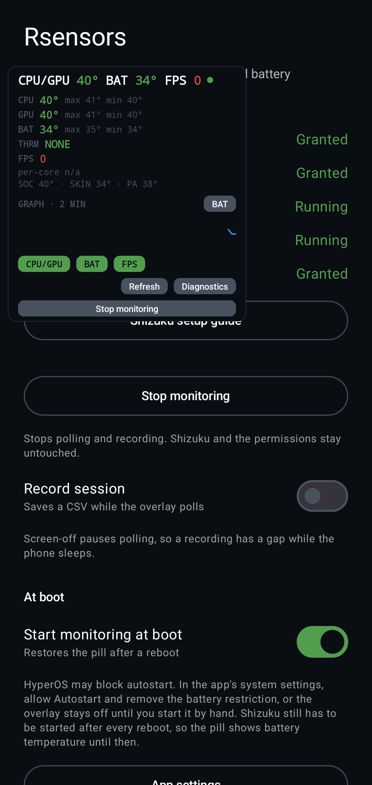
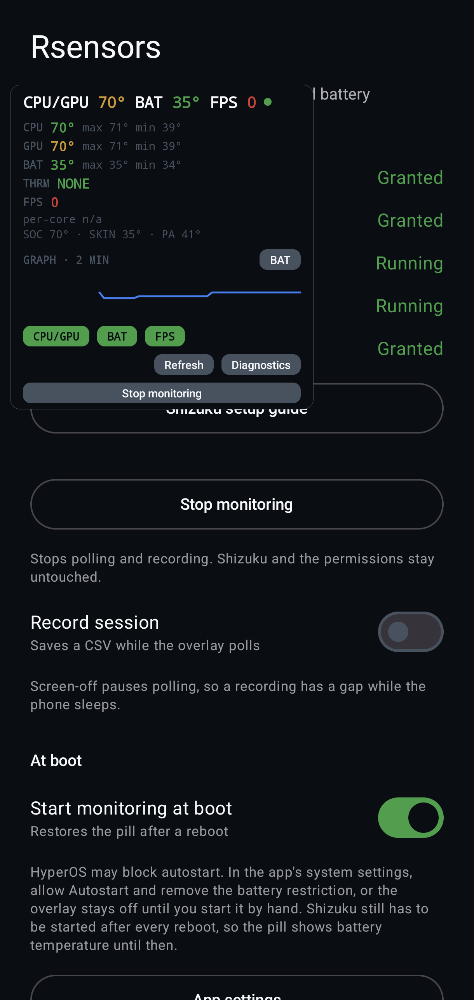
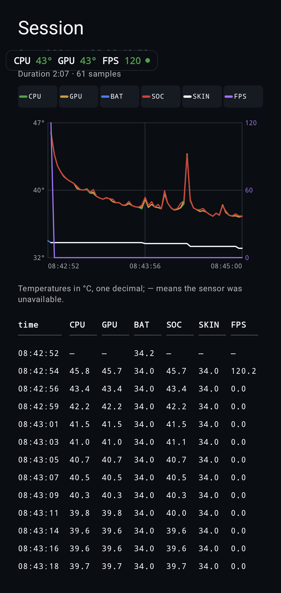

# Rsensors

A floating Android monitoring app. It shows CPU/GPU and battery temperatures,
FPS and RAM in an always-on-top pill, and opens into a card with details,
session recording and process memory. CPU/GPU temperatures, FPS, process memory
and app stopping require Shizuku; battery temperature, thermal status and system
RAM work without it. Diagnostics reports what the current phone exposes and why
a feature is unavailable.



## Features

### Pill

- `CPU/GPU`, `BAT`, `FPS` and `RAM`, with a source dot.
- CPU/GPU is the hotter SoC value and the worse of the two levels; RAM is used
  memory.
- Values dim when stale; missing values render `—`.

### Card

- Individual CPU, GPU and battery readings with 2-minute max/min.
- Thermal status, FPS, and system RAM used/total with a bar.
- 2-minute sparkline with a `CPU+GPU / CPU / GPU / BAT / FPS` selector.
- `CPU/GPU / BAT / FPS / RAM` chips choose what the pill and notification show.
- `Record session`, `Refresh`, `Diagnostics` and `Stop monitoring`.

### Process memory

- Tap the RAM row for a paged list, eight per page.
- PSS from `dumpsys meminfo`; falls back to RSS from `ps` and labels the metric.
- `Apps` groups by package and hides Native/System on the PSS route;
  `Processes` shows every process.
- `Refresh` and `Back`; the pill keeps updating. Without Shizuku the page
  explains why it is unavailable.

### Stop app

- Select a row, then Stop and confirm.
- Protected: Rsensors, Shizuku, native/unknown, core system, OEM security and
  power managers, persistent apps.
- Warnings: system apps, foreground apps, launcher, keyboard, Play services and
  AICore.
- Hidden app details are resolved for the selected package only; hidden
  Processes rows stay protected.
- `am force-stop` stops the whole app; a `ps` check reports survivors; no undo.

### FPS

- The focused app's presented frames from SurfaceFlinger; idle reads 0; the
  overlay's own frames are excluded.
- The graph axis starts at 0–120 and expands in 30 fps steps.
- A changed foreground app is picked up on the next poll.

### Recording

- CSV v2 with FPS, one file per session.
- Sessions list and full-session graph; legend chips and column help; long-press
  delete.
- Screen-off pauses polling, leaving a gap.

### Diagnostics

- Eight rows: battery, thermal status, CPU/GPU, board, FPS, RAM, process memory
  and Stop app.
- Each row shows state, source and reason; the screen also shows source and
  age, Shizuku state and version, sysfs errors, and the thermal-zone table.

### Setup guide

- In-app Shizuku setup, the "Start keeps searching" fix, pairing reset, after
  reboot, BAT-only, and version checks.
- Links the 13.5.4 release and gives the install steps.

### Placement and boot

- Drag the pill. `Snap to edges` keeps an 8 dp margin from the nearer side, or
  the exact drop position when off.
- Optional start after the first unlock following a reboot.

## Screenshots

| Collapsed pill | Expanded card |
|---|---|
|  |  |

| Session graph | Setup guide |
|---|---|
|  |  |

## Requirements

| | |
|---|---|
| Android | 8.0 (API 26) or newer; target API 36 |
| Shizuku | required for CPU/GPU temperatures, FPS, process memory and stopping apps |
| Permissions | display over other apps, notifications |
| Verified on (only) | POCO X7 Pro, Android 16 / HyperOS |
| Verified Shizuku | 13.5.4 |

Battery temperature, thermal status and system RAM work without Shizuku.

Shizuku 13.6.0 supports Android 16 QPR1 in general, but on the verified
HyperOS/MediaTek device its UserService fails to start (upstream issues
[#2629](https://github.com/RikkaApps/Shizuku/issues/2629) and
[#2633](https://github.com/RikkaApps/Shizuku/issues/2633)); 13.5.4 is the
working version there. Android refuses an in-place downgrade, so uninstall
Shizuku first. That clears its pairing and permission data, and Rsensors has to
be granted the permission again. The setup guide links the
[13.5.4 release](https://github.com/RikkaApps/Shizuku/releases/tag/v13.5.4) and
gives the download and install steps. If 13.6.0 works on your phone, keep it.

## Install

1. Download the APK from [Releases](https://github.com/reswanaadiwarga/rsensors/releases/latest)
   and install it with `adb install` or a file manager.
2. Open Rsensors and grant **Display over other apps** and **Notifications**.
3. Install and start [Shizuku](https://shizuku.rikka.app/). Allow Shizuku to
   send notifications: the pairing code is entered in its notification. Then
   grant Rsensors the Shizuku permission.
4. Tap **Start monitoring**. The pill appears; the expanded card is one tap.
5. For the detailed Shizuku flow, open **Shizuku setup guide** in the app.

The ongoing notification opens the main screen and has a Stop action.

## Permissions

| Permission | Use |
|---|---|
| `SYSTEM_ALERT_WINDOW` | the floating overlay |
| `FOREGROUND_SERVICE`, `FOREGROUND_SERVICE_SPECIAL_USE` | polling, overlay and recording |
| `POST_NOTIFICATIONS` | the ongoing foreground-service notification |
| `RECEIVE_BOOT_COMPLETED` | optional start at boot |
| `moe.shizuku.manager.permission.API_V23` | Shizuku binder permission, granted in Shizuku |

No `INTERNET` permission. No accessibility service, screen capture or root.

## Privacy

- Sensor data, session files and settings stay on the device.
- Session CSVs live in the app's private `filesDir/sessions` directory and can
  be deleted from the Sessions screen.
- No analytics, ads or network calls.
- Shizuku runs a shell-side service; Rsensors calls only the thermal,
  SurfaceFlinger and memory dumps it needs through that service.

## Device support

"Verified" means the named build was run on the POCO X7 Pro. It is not a claim
that every Android 8+ phone exposes every measurement.

- **No shell:** battery temperature, thermal status (Android 10+), system RAM,
  own-app data, overlay, recording, sessions and settings. OEM policy can still
  block the overlay or autostart.
- **Shizuku:** CPU/GPU temperatures, FPS, process memory and stopping apps. The
  platform or OEM may omit a sensor, use a different SurfaceFlinger layer or
  `dumpsys` format, or refuse a command.
- **Diagnostics is the source of truth:** each feature has a state (`OK`,
  `DEGRADED`, `UNAVAILABLE`, `BLOCKED`, `UNKNOWN`), a source and the exact
  reason — for example Shizuku not running, permission missing, no focused
  layer, no matching thermal zone, no process rows, or a protected package.

## Compatibility notes

These are setup hints for common OEM software, not verified support. Only the
POCO X7 Pro build above has been run on a phone. The research and limits are in
[docs/UNIVERSALITY.md](docs/UNIVERSALITY.md).

| Device family | Autostart / background | Shizuku note |
|---|---|---|
| AOSP / Pixel | No OEM autostart manager; battery optimization can still stop the overlay. | Start the Shizuku server again after a reboot. |
| Samsung | Remove Rsensors from Sleeping apps and Deep sleeping apps; Auto Blocker may block sideloading. | Keep Shizuku out of Sleeping apps, or the server can stop while the screen is off. |
| Xiaomi / HyperOS | Allow Autostart and Background autostart, set battery to No restrictions, and lock the app in Recents. | Allow Shizuku to autostart; toggle Wireless debugging if Start keeps searching. |
| Huawei / HONOR | App launch → Manage manually, with Auto-launch, Secondary launch and Run in background. | Many builds lack Wireless debugging; use USB debugging. |
| ColorOS / Oppo / Realme | Allow Auto launch and background activity, and turn off system optimization for Rsensors. | Permission monitoring can revoke Shizuku's grant after a reboot. |
| vivo / iQOO | Allow Autostart and high background power use. | Start Shizuku again after a restart and check that it is allowed to autostart. |

HarmonyOS NEXT does not run Android APKs, so no Android build of Rsensors can
be installed there.

## Build and test

Requirements: JDK 17+, Android SDK 36. From the project root:

```bat
gradlew.bat :app:testDebugUnitTest
gradlew.bat :app:lintDebug
gradlew.bat :app:assembleDebug
gradlew.bat :app:assembleRelease
```

The JVM suite covers the pure logic: formatting, thresholds, pill segmentation,
FPS parsing/freshness/cache rules, CSV v1/v2 round-trips, session chart
geometry, zone mapping and thermal aliases, visibility, ranges, RAM formatting,
meminfo/PSS/RSS parsing, process grouping and paging, the stop-risk policy and
post-stop matching, package facts, capability status precedence, OEM guidance
and the Shizuku version warning. It does not need a device.

The internal design and task log is [ANDROID.md](ANDROID.md); source comments
cite its sections.

See [docs/BUILDING.md](docs/BUILDING.md) for signing, R8 and the release
details, and [docs/VERIFICATION.md](docs/VERIFICATION.md) for what is verified
on this phone versus what remains untested.

## Release

| | |
|---|---|
| File | `rsensors-0.3.0.apk` ([Releases](https://github.com/reswanaadiwarga/rsensors/releases/latest)) |
| Size | 1,155,040 bytes |
| Version | 0.3.0 (versionCode 3) |
| SHA-256 | `f356da99f680a5af891a3a6e32232e7d623d3b88ba4834ac8d89623f80255c7e` |
| Signature | APK Signature Scheme v2, local debug key |
| Shrinking | R8 full mode and resource shrinking |

The release APK is signed with a local debug key for personal sideloading.
Replace the key before distributing the app; see
[docs/BUILDING.md](docs/BUILDING.md#release-signing). The APK is built from the
source covered by the 417 JVM tests; the R8 keep rule protects the Shizuku
UserService.

Verified on the POCO X7 Pro only (2026-11-24): 0.3.0 installed over the debug
build with data preserved. The R8 UserService served thermal, FPS, meminfo and
process-UID calls; Diagnostics reported all eight features `OK`; the process
page showed 267 PSS rows as 81 apps and 267 processes. No FATAL or ANR was
logged. The stop action and hidden-package dump were not re-run in this release
smoke. This is not a compatibility statement for other phones.

## Known limitations

- Only the POCO X7 Pro / Android 16 / HyperOS combination above is
  device-verified. Other devices may lack sensors, use different
  SurfaceFlinger/`dumpsys` formats, or block Shizuku. Diagnostics reports the
  per-feature state and reason instead of claiming the feature works there.
- CPU/GPU temperatures, FPS and process memory require Shizuku. Without it the
  pill shows `CPU/GPU —` and `FPS —` alongside the battery and RAM values, and
  Diagnostics reports the missing shell tier.
- When Shizuku is unavailable, stop an app by hand: **Manage apps** on the main
  screen opens Android's app list, where you can open the app and tap **Force
  stop**. Android asks for confirmation; Rsensors cannot verify or undo that
  stop.
- FPS is the focused app's presented frame rate. A static app reports 0; the
  display's refresh rate is not reported.
- Screen-off pauses polling, so a recording has a gap while the phone sleeps.
- After a reboot Shizuku must be started again; the overlay starts after the
  first unlock when the boot switch is on.
- On the tested POCO X7 Pro the app UID cannot list `/sys/class/thermal`, and
  per-core temperatures are absent. Diagnostics reports the denial; the manual
  zone overrides are inert on that device.
- Sessions recorded with 0.1.0 (CSV v1) open without an FPS series or column.
- The release APK is debug-signed; see above.

## License

MIT. See [LICENSE](LICENSE).

Rsensors is not affiliated with Shizuku. Shizuku is a separate project by
RikkaApps.
